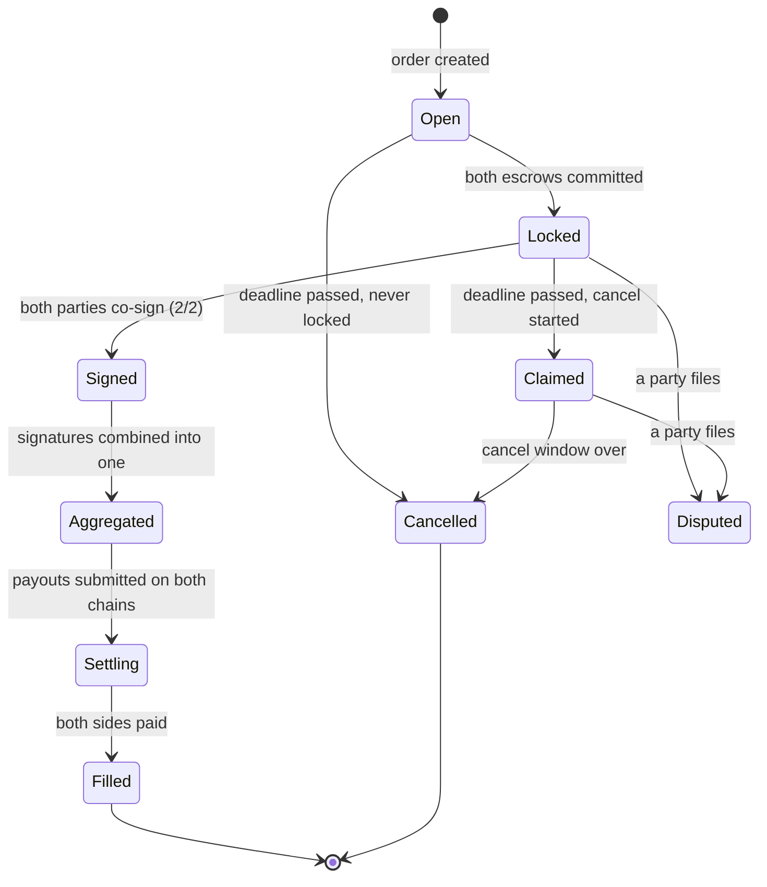

Settlement is authorized by two BLS signatures, one from each party, over
one fixed message: the **SettlementAuth**.

## What gets signed

Eight fields, byte-identical for both parties:

| Field | Meaning |
| --- | --- |
| `orderChainId` / `adChainId` | the two chains of this trade |
| `orderHash` | the hash binding every order parameter: amounts, parties, recipients, deadline, fees |
| `orderChainRoot` / `adChainRoot` | both chains' Merkle roots at signing time |
| `makerKeyCommitment` | the one Maker key this pair of signatures is valid with |
| `adLegNullifier` / `orderLegNullifier` | the nullifier each payout must use |

The message is tagged so a settlement signature can't be mistaken for
anything else.

Because it commits to the order, both roots, the Maker's key and both
nullifiers, a signature authorizes exactly one settlement of exactly one
trade, against exactly the deposits that existed. At payout, each chain
refuses the signature if:

- it was made over a different order
- the chain, root or nullifier doesn't match this payout
- on the ad chain, the Maker's key isn't the one pinned when the order
  was locked
- either party's key isn't live in the registry

Before signing, each party's app checks the nullifier against its own
[half of the trade secret](/v3/concepts/trade-secrets), and the Bridger's
app checks the Maker's named key on the ad chain.

## Who signs

The trade's two parties: the Maker's **settlement signer** (named on the
ad) and the Bridger. Each signs with the key registered for that wallet.
The relayer doesn't sign.

Signing happens in the app, with no on-chain transaction. Parties sign
independently, in any order.

## After both have signed

As soon as both signatures are in, either party can fetch the pair and
keep it, so neither depends on the relayer to settle. The first signer's
signature is never shown before the second has signed.

If the Maker's pinned key ends before the trade settles, the relayer
drops the pair and asks both parties to sign again.

## The status ladder

| State | Meaning |
| --- | --- |
| `Open` | order created, deposits pending |
| `Locked` | both escrows committed; co-signing starts once deposits confirm |
| `Signed` | signatures collected (shown as 1/2, then 2/2) |
| `Aggregated` | the two signatures combined; proofs being built |
| `Settling` | payouts submitted on-chain |
| `Filled` | both sides paid; trade complete |
| `Claimed` | the deadline passed and a cancel was started; the cancel window is open |
| `Cancelled` | the trade ended without settling; funds returned |
| `Disputed` | a party filed a dispute |

The status also shows whether the Maker has **halted** settlement, and
any reason a payout can't go through (for example, a nullifier mismatch,
in which case the trade is refunded at its deadline).

Everything after `Signed (2/2)` is automatic. The relayer combines,
proves and submits; it can't forge either signature and can't settle
without both.
