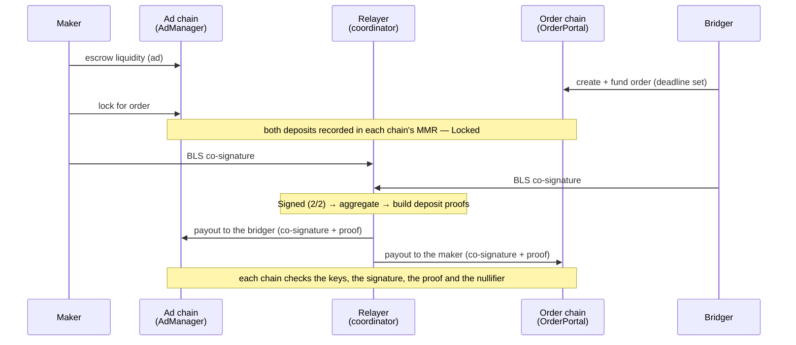

A trade that settles normally moves through these states:

```
Open → Locked → Signed (2/2) → Aggregated → Settling → Filled
```

A trade that doesn't settle by its deadline ends another way: it's
cancelled and refunded, or it's disputed and ruled on. Every order has
one of these endings.



## 1. The maker posts an ad

A maker escrows liquidity in the **AdManager** on their chain for a route,
say ETH on Sepolia → wETH on Stellar, with per-trade limits. The ad names
the **settlement signer**: the wallet whose settlement key co-signs the
maker's side of every trade. See [Liquidity ads](/v3/concepts/liquidity-ads).

## 2. The bridger opens an order

The bridger picks an ad and enters an amount. The app shows what they
pay, the [fee](/v3/concepts/fees) and what they receive. Creating the
order reserves the matching slice of the maker's ad; a reservation that
isn't funded within ~30 minutes is released.

The bridger funds the order: their tokens go into the **OrderPortal**
escrow on the order chain. The order carries a **deadline**, the time by
which the trade has to settle ([Deadlines and clocks](/v3/concepts/deadlines-and-clocks)).

## 3. The maker locks

The maker, or their [agent](/v3/concepts/agents), locks the matching
funds from the ad. Both escrows are now committed to this trade: state
**Locked**.

Each deposit is recorded in that chain's
[Merkle Mountain Range](/v3/concepts/merkle-mountain-range), the
append-only tree the deposit proofs are built against.

## 4. Each party has its half of the trade secret

Each payout needs a one-time secret. In v3 each party derives its own half
of that secret from a wallet signature. See [Trade secrets](/v3/concepts/trade-secrets).

## 5. Both parties co-sign

Once both deposits are confirmed deeply enough to settle against, each
party signs the **SettlementAuth** with their registered settlement key.
The message binds this exact order, both chains' Merkle roots, the
maker's named key and each payout's nullifier, so a signature can't be
reused for anything else. Signing happens in the app, with no
transaction and no gas. See [Co-signing](/v3/concepts/co-signing).

## 6. The rest is automatic

1. **Aggregate:** the two BLS signatures combine into one.
2. **Prove:** a zero-knowledge proof is built for each payout, showing
   the other side's deposit is in the other chain's Merkle root.
3. **Submit:** the relayer submits the payout on each chain and pays the
   gas.

State advances **Aggregated → Settling → Filled**. Once both signatures
are in, either party can also fetch the signature pair and keep it, so
neither depends on the relayer for it.

## 7. On-chain checks

Each payout checks, before releasing funds:

- the **combined BLS signature**, against the keys registered for the
  two parties in the on-chain `BLSKeyRegistry`
- the **zero-knowledge deposit proof**, against the other chain's Merkle
  root
- the **nullifier**: each payout happens exactly once

Payouts are permissionless. The transaction data is public, and the
funds always go to the recipient fixed in the order, whoever submits.

## When a trade doesn't settle

If the deadline passes without a payout, the trade still ends:

- **Cancel and refund.** Anyone can start a cancel after the deadline.
  After a short cancel window, the maker's lock is released and the
  bridger's deposit is refunded. No fee is taken. See
  [Cancels and refunds](/v3/concepts/cancels-and-refunds).
- **Dispute.** Either party can file a dispute on the ad chain, with
  evidence. Evidence that the trade settled always wins; otherwise a
  ruling decides, and no ruling means both sides are refunded. See
  [Disputes](/v3/concepts/disputes).
